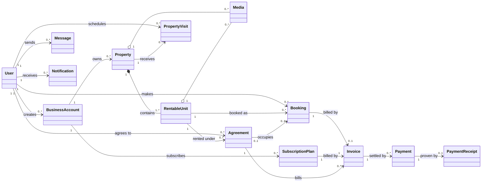
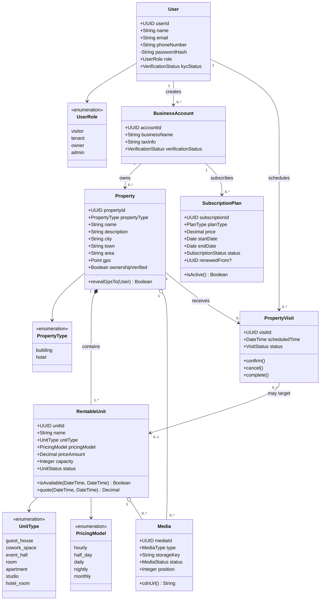
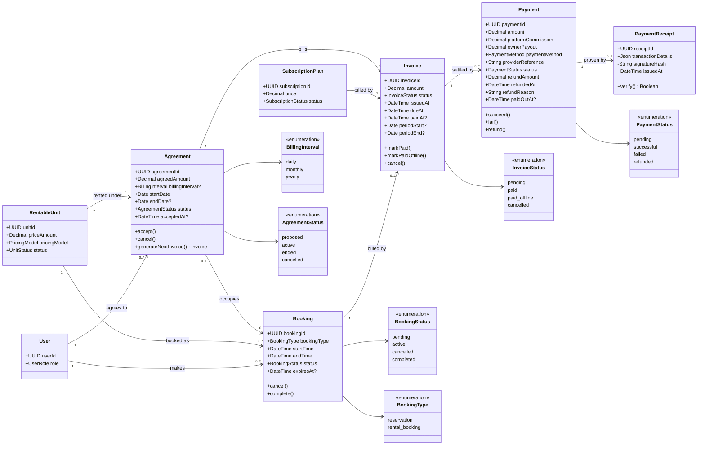
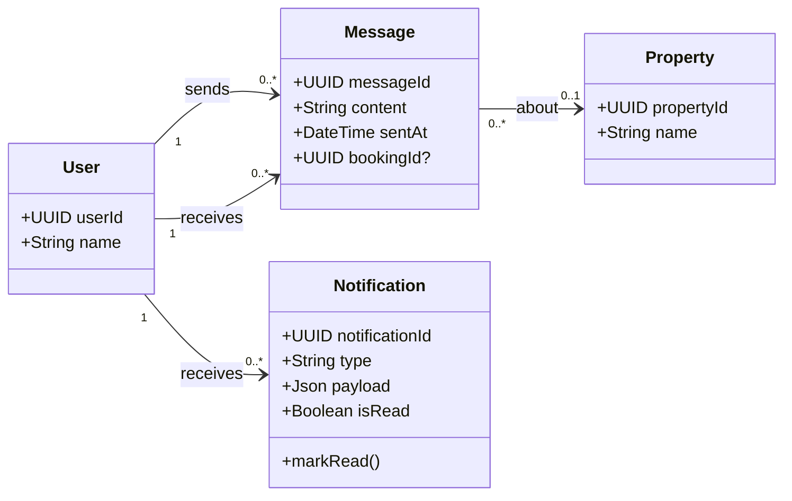
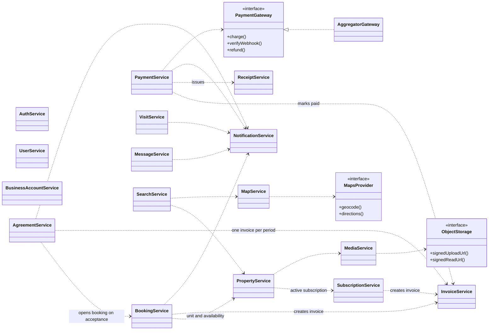
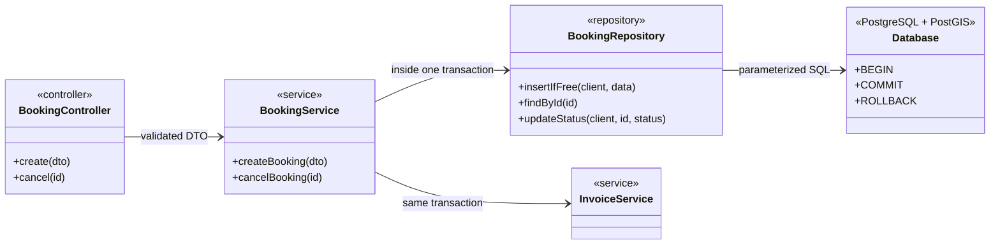

# Annorent — Class Diagrams

> Object-level view of the domain, for the team to read and discuss. Derived from
> `database-model.md` (what is stored), which follows the team's "Real Estate Platform Schema".
> Mermaid renders natively on GitHub and in VS Code, so the diagrams live in the repo and get
> reviewed in PRs.

## How to read these

- **One overview, then one diagram per area.** Classes repeat across diagrams on purpose, so
  each stays readable on its own.
- **Classes map 1:1 to tables** in `database-model.md` (`PropertyVisit` ↔ `property_visits`).
- **`User` is one class with a `role`** (tenant, owner, admin), not a subclass per role. What a
  role may do is decided by guards and services, not by the class. **`visitor` is a fourth
  role for someone with no account**, so it has no `User` object and is never stored.
- **Only a `BusinessAccount` owns properties and subscribes.** A `User` never does. An owner
  creates business accounts, and everything else hangs off them.
- **Hotels and buildings are both `Property`**, told apart by `propertyType`. A hotel room, an
  apartment and a co-work space are all `RentableUnit`.
- Enumerations appear only where the values drive behavior. The full list is in
  `database-model.md` §4.
- Visibility: `+` public, `-` private. Methods are kept to the few that carry a business rule.
  The rules themselves live in services (§5), not in these classes.

## 1. Domain overview

## 2. Ownership & listings

> A property and a subscription each belong to exactly one `BusinessAccount` (`account_id`,
> NOT NULL). A `User` never owns or subscribes. Only a user with role `owner` can create a
> business account.
>
> `visitor` is in the `UserRole` enum because guards resolve every unauthenticated request to
> it, but no `User` object or `users` row ever has that role. A visitor can browse and search
> only. Booking, messaging, visits and payments need an account.

## 3. Booking & payment

> **Flow.** Creating a booking also creates its invoice, in one transaction. A payment can only
> exist against an invoice. When a payment succeeds, the invoice becomes `paid` and the receipt
> is issued, again in one transaction. A `reservation` is a booking of a hotel unit, a
> `rental_booking` a booking of a building unit.
>
> **Holds.** A booking made in the app starts `pending` with an `expiresAt` and blocks the unit like an
> `active` one. Paying the invoice makes it `active`. A job cancels expired unpaid bookings and their invoices.
>
> **Agreements.** An owner proposes an `Agreement` (negotiated price, start date, optional daily, monthly or
> yearly repeat). When the tenant accepts, its booking is created and invoices are generated one per period.
> The tenant can pay in the app, or the owner marks the invoice `paid_offline`.

## 4. Messaging & notifications

> A conversation is not a stored object. It is the messages between two users, grouped by the
> query. Live delivery goes through the realtime service (WebSocket).

## 5. Backend layers (NestJS)

How the classes above are used. Controllers do HTTP only, services own the rules, repositories
are the only code that writes SQL (raw `pg`, no ORM). External systems sit behind **ports**
(interfaces), so a provider can be swapped without touching services.

### 5.1 Service dependencies

### 5.2 Layering, worked example

The same shape repeats for every module.

> `createBooking` opens one transaction, calls `insertIfFree` (the `EXCLUDE` constraint rejects
> an overlap), creates the invoice, and commits or rolls back both together.

## 6. Keeping this current

- Changing an entity updates `database-model.md` **and** the matching diagram here, in the
  same PR.
- A new service dependency updates §5.1. A circular arrow there is a design bug.
- Class names here are the names used in code (`PropertyVisit`, `RentableUnit`). Do not invent
  synonyms in TypeScript.
