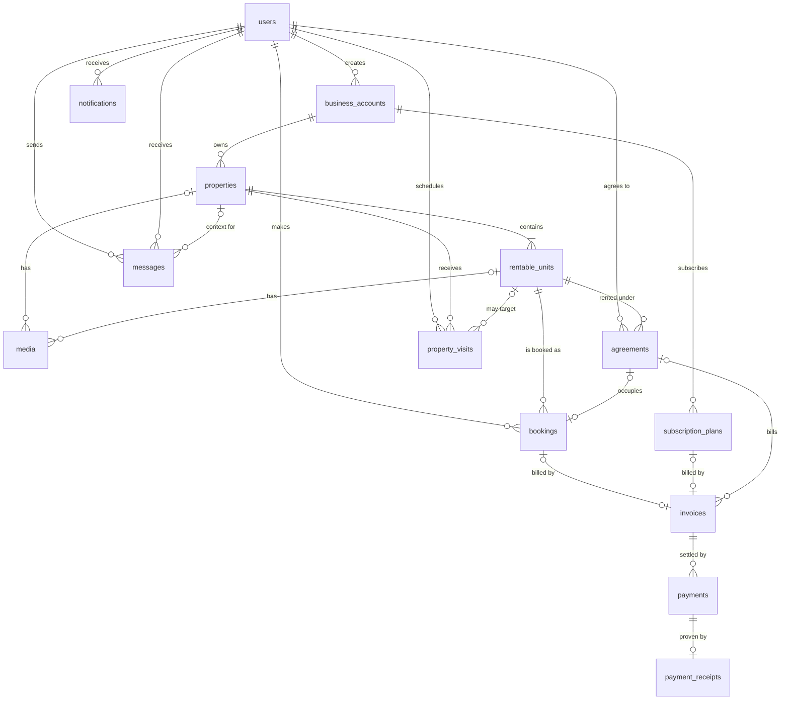

# Annorent — Database Model (Entities, Attributes, Relationships)

> The logical model: what exists, what it holds, how it connects. **Source of truth is the
> team's "Real Estate Platform Schema" doc.** This file follows it and adds only what the
> already-designed screens and the stated NFRs cannot work without. Every addition is listed
> in §7 so it can be accepted or removed. Physical details (indexes, SQL constraints,
> migrations) live in `database-schema.md`.

## 1. Conventions

- Tables are `snake_case` plural. Primary keys are `<entity>_id uuid default gen_random_uuid()`
  (the team schema's naming). A foreign key reuses the name of the key it points at
  (`property_id`, `unit_id`).
- Every table has `created_at timestamptz default now()`. It is omitted from the attribute
  tables below unless the team schema names it. Tables that are updated also carry
  `updated_at timestamptz default now()`; the two insert-only tables
  (`payment_receipts`, `audit_logs`) do not. One shared `set_updated_at()` trigger keeps the
  column current on every table that has it.
- Money is `numeric(14,2)` in XAF. There is no `currency` column until a second currency is real.
- Enums are Postgres enum types with lowercase snake values (`Half-Day` in the team doc is
  `half_day`). Required extensions: `postgis`, `btree_gist`, `pgcrypto`, `citext`.
- "Exactly one parent" links (a media row belongs to a property **or** a unit, an invoice bills
  a booking **or** a subscription) use two nullable foreign keys plus
  `CHECK (num_nonnulls(a, b) = 1)`, so the database enforces it.

## 2. Entities

| Entity | Purpose |
|---|---|
| `users` | Anyone with an account: tenant, owner or admin. Visitors have no account and no row |
| `business_accounts` | A company an owner creates. The **only** owner of properties and the **only** subscriber |
| `properties` | A physical place: a **building** or a **hotel**. Holds the address |
| `rentable_units` | What is actually rented: apartment, studio, hotel room, co-work space, event hall… |
| `media` | Photos, video tours and 3D tours of a property or unit |
| `bookings` | A user's reservation (hotel) or rental booking (building) of a unit |
| `agreements` | A price negotiated between an owner and one tenant for a unit, with its due date and optional repeat. Generates invoices |
| `invoices` | Bill issued before any payment. One per booking, subscription or agreement period |
| `payments` | Settlement of an invoice, with the commission/payout split |
| `payment_receipts` | Proof of a successful payment |
| `property_visits` | In-person inspection appointments |
| `subscription_plans` | A paid subscription a business account needs to keep its listings active |
| `messages` | Direct messages between two users, optionally about a property |
| `notifications` | In-app and real-time notifications |

Supporting tables, not domain entities: `refresh_tokens` (auth rotation, see `security.md`) and
`audit_logs` (NFR-S5). Both are defined in §4.12.

## 3. Relationship diagram

## 4. Entity catalogue

### 4.1 `users`

| Attribute | Type | Notes |
|---|---|---|
| user_id | uuid PK | |
| name | text | |
| email | citext, unique | |
| phone_number | text, unique, nullable | E.164, also used for Mobile Money. Nullable so card/bank-only users are not forced to give one |
| password_hash | text | argon2 or bcrypt |
| role | enum `user_role` | tenant, owner, admin. **Stored roles only**, see below for `visitor` |
| kyc_status | enum `verification_status` | pending (default), verified, rejected |

The team schema lists `access_token` here. It is **not stored**: access tokens are stateless
JWTs (`security.md`). Refresh tokens are stored in `refresh_tokens`.

**Roles.** There are four, but only three are stored. A **visitor** is anyone without an
account or a valid token. It has no `users` row, so it is not a value of the stored `role`
column. Guards treat any unauthenticated request as `visitor`, and the application-level
`UserRole` has all four values.

| Role | Stored | Can do |
|---|---|---|
| visitor | no | browse and search listings, open property and unit pages with media, use the map, read public pages. GPS stays hidden. Cannot book, message, schedule visits or pay |
| tenant | yes | everything a visitor can, plus book units, pay invoices, accept agreements, schedule property visits, message owners, receive notifications |
| owner | yes | create and manage **business accounts**, and through them properties, units and media. See and cancel bookings on their units, confirm visits, message tenants, propose agreements and invoice a tenant at a negotiated price |
| admin | yes | verify KYC, business accounts and property ownership, manage users, monitor payments, read `audit_logs` |

This matrix comes from the SRS roles table and the team schema. Adjust it if a capability is
wrong. A user who is not an `owner` cannot create a business account.

### 4.2 `business_accounts`

| Attribute | Type | Notes |
|---|---|---|
| account_id | uuid PK | |
| user_id | uuid FK → users | the owner who created it (role `owner`) |
| business_name | text | |
| tax_info | text | tax id and compliance details |
| verification_status | enum `verification_status` | admin sets it |

**Only a business account owns properties and subscribes.** A user never does, whether the
properties are buildings or hotels. An owner who wants to list must first create a business
account.

### 4.3 `properties`

| Attribute | Type | Notes |
|---|---|---|
| property_id | uuid PK | |
| account_id | uuid FK → business_accounts, NOT NULL | the owning business account |
| property_type | enum | building, hotel |
| name | text | *addition* |
| description | text | *addition* |
| country, city, town, area | text | `country` defaults to `CM`. Structured so search can filter |
| street | text, nullable | |
| gps | geography(Point,4326) | *addition*, GIST index. Needed for map search. The code type is `location: {lat, lng} \| null`, null when the caller may not see it (§6.5) |
| ownership_verified | boolean, default false | title/ownership proof validated by KYC. Unverified properties are not listed |
| archived_at | timestamptz, nullable | set when the owner removes the listing. Bookings and invoices keep pointing at it, so rows are archived, never deleted |

### 4.4 `rentable_units`

| Attribute | Type | Notes |
|---|---|---|
| unit_id | uuid PK | |
| property_id | uuid FK → properties | |
| name | text | *addition*. "Room 12", "Studio B" |
| unit_type | enum | guest_house, cowork_space, event_hall, room, apartment, studio, hotel_room |
| pricing_model | enum | hourly, half_day, daily, nightly, monthly |
| price_amount | numeric(14,2) | price per `pricing_model` unit |
| capacity | smallint | *addition* |
| bedrooms, bathrooms | smallint, nullable | *addition*, for building units |
| area_sqm | numeric, nullable | *addition* |
| status | enum | available (default), maintenance |
| archived_at | timestamptz, nullable | same meaning as on `properties` |

`status` is the owner/system flag (maintenance blocks booking). Availability **for a date
range** is computed from `bookings`, never from this flag — `occupied` was removed so there
is a single source of truth. `unit_type` should match the parent
`property_type` (`hotel_room` only under a hotel); the service enforces it.

### 4.5 `media`

| Attribute | Type | Notes |
|---|---|---|
| media_id | uuid PK | |
| property_id | uuid FK, nullable | exactly one of `property_id`, `unit_id` |
| unit_id | uuid FK, nullable | |
| type | enum | photo, video, tour_3d |
| storage_key | text | object-storage key. The CDN URL is derived, not stored |
| status | enum | uploading, processing, ready, failed (set by the Python workers) |
| position | smallint | gallery order |

### 4.6 `bookings`

One table for both kinds. The team's terms: a **Reservation** is a booking of a hotel unit, a
**Rental Booking** is a booking of a building unit.

| Attribute | Type | Notes |
|---|---|---|
| booking_id | uuid PK | |
| user_id | uuid FK → users | the renter |
| unit_id | uuid FK → rentable_units | |
| booking_type | enum | reservation, rental_booking. Set by the service from the property type |
| start_time | timestamptz | |
| end_time | timestamptz | `CHECK end_time > start_time` |
| status | enum | pending, active, cancelled, completed. `pending` holds the unit until the invoice is paid, `active` once confirmed |
| expires_at | timestamptz, nullable | for a `pending` booking made in the app: when the hold lapses if still unpaid (§6.9) |
| cancelled_at | timestamptz, nullable | |

### 4.6a `agreements`

A price negotiated between an owner and **one** tenant for a unit. It is not the unit's list
price and affects no one else. The agreement carries the schedule, and invoices are generated
from it, so an invoice stays a single bill.

| Attribute | Type | Notes |
|---|---|---|
| agreement_id | uuid PK | |
| unit_id | uuid FK → rentable_units | the unit being rented |
| tenant_id | uuid FK → users | the customer. Needs an account |
| booking_id | uuid FK, nullable, unique | the occupancy. Created when the tenant accepts, so the unit is blocked from then on |
| agreed_amount | numeric(14,2) | negotiated price per billing period |
| billing_interval | enum `billing_interval`, nullable | daily, monthly, yearly. Null means a one-time charge |
| start_date | date | first due date. Each period is billed in advance, starting on this date |
| end_date | date, nullable | null means open-ended. `CHECK end_date > start_date` |
| status | enum `agreement_status` | proposed (default), active, ended, cancelled |
| accepted_at | timestamptz, nullable | set when the tenant accepts |

The owner creates it as `proposed`. The tenant accepts, and it becomes `active`. A tenant can
pay through the app or outside it (`invoices.status = paid_offline`). A booking made through an
agreement has no invoice of its own: the agreement's invoices bill it.

### 4.7 `invoices`

| Attribute | Type | Notes |
|---|---|---|
| invoice_id | uuid PK | |
| booking_id | uuid FK, nullable, unique | one invoice per booking |
| subscription_id | uuid FK, nullable, unique | *addition*, see §7 |
| agreement_id | uuid FK, nullable | one invoice per billing period of an agreement |
| amount | numeric(14,2) | booking: unit price × number of pricing units, computed server-side. Agreement: copied from `agreed_amount` when generated |
| status | enum | pending, paid, paid_offline, cancelled. `paid_offline`: the owner confirms payment outside the app (no `payments` row, no commission) |
| issued_at | timestamptz | |
| due_at | timestamptz | when payment is expected. Overdue is computed (`pending` and past `due_at`), not stored |
| paid_at | timestamptz, nullable | set with `paid` or `paid_offline` |
| period_start, period_end | date, nullable | billing period. Agreement invoices only |

`CHECK (num_nonnulls(booking_id, subscription_id, agreement_id) = 1)`.
`UNIQUE (agreement_id, period_start)`, so the generator job can run twice without billing a period twice.

### 4.8 `payments`

| Attribute | Type | Notes |
|---|---|---|
| payment_id | uuid PK | |
| invoice_id | uuid FK → invoices, NOT NULL | no payment without an invoice |
| amount | numeric(14,2) | |
| platform_commission | numeric(14,2) | kept by the platform |
| owner_payout | numeric(14,2) | net to the owner. `CHECK amount = platform_commission + owner_payout` |
| payment_method | enum | mobile_money, bank_transfer, card |
| provider_reference | text, unique | *addition*. Aggregator transaction id, also the idempotency key |
| status | enum | pending, successful, failed, refunded. `pending` is an *addition* |
| refund_amount | numeric(14,2), nullable | *addition*. Partial refunds allowed: a full refund sets `status = refunded` and `refund_amount = amount`; a partial refund keeps the status and sets a smaller amount |
| refunded_at | timestamptz, nullable | *addition*. Set together with `refund_amount` |
| refund_reason | text, nullable | *addition* |
| paid_out_at | timestamptz, nullable | when the owner's share was actually sent. Null until then, and always null for subscription payments |

The commission **rate** is app configuration for now, not a table. A subscription payment is
`platform_commission = amount`, `owner_payout = 0`.

### 4.9 `payment_receipts`

| Attribute | Type | Notes |
|---|---|---|
| receipt_id | uuid PK | |
| payment_id | uuid FK, unique | |
| invoice_id | uuid FK | |
| transaction_details | jsonb | breakdown of what was paid |
| signature_hash | text | *addition*. Makes the receipt verifiable and tamper-resistant (NFR-R2) |
| issued_at | timestamptz | |

The downloadable slip is rendered from `transaction_details`. No file is stored.

### 4.10 `property_visits`

| Attribute | Type | Notes |
|---|---|---|
| visit_id | uuid PK | |
| user_id | uuid FK → users | the visitor |
| property_id | uuid FK → properties | a hotel inspection is a visit to a hotel property |
| unit_id | uuid FK, nullable | optional: a general building visit has no unit |
| scheduled_time | timestamptz | reminders are computed from this, not stored |
| status | enum | requested, confirmed, completed, cancelled |

### 4.11 `subscription_plans`, `messages`, `notifications`

**`subscription_plans`**. Despite the name, each row is one business account's subscription
(the team schema's `subscription_id` key).

| Attribute | Type | Notes |
|---|---|---|
| subscription_id | uuid PK | |
| account_id | uuid FK → business_accounts, NOT NULL | only a business account can subscribe |
| plan_type | enum | monthly, yearly |
| price | numeric(14,2) | |
| start_date, end_date | date | |
| status | enum | active, expired, cancelled |
| renewed_from | uuid FK → subscription_plans, nullable | *addition*. A renewal is a new row pointing at the instance it replaces, so billing history chains |

**`messages`**. A conversation is simply the messages between two users, grouped in the query.

| Attribute | Type | Notes |
|---|---|---|
| message_id | uuid PK | |
| sender_id, receiver_id | uuid FK → users | |
| property_id | uuid FK, nullable | what the inquiry is about |
| booking_id | uuid FK, nullable | *addition*. Lets an inquiry anchor to a specific booking, not just a property |
| content | text | |
| sent_at | timestamptz | |

**`notifications`**: `notification_id` PK, `user_id` FK, `type` text, `payload` jsonb, `is_read`
boolean. Kept because the team doc relies on automated notifications (for example on cancellation).

### 4.12 Supporting tables

- **`refresh_tokens`**: `token_id` PK, `user_id` FK, `token_hash` unique, `family_id` uuid,
  `expires_at`, `revoked_at`, `updated_at`. One family per login. Reuse of a rotated token revokes the family.
- **`audit_logs`**: `log_id` PK, `actor_id` FK nullable, `action` text, `entity_type` text,
  `entity_id` uuid, `request_id` text. Insert-only. Written on payments, booking status changes
  and admin approvals.

## 5. Relationship summary

| From | To | Cardinality | Rule |
|---|---|---|---|
| users | business_accounts | 1 : 0..* | only users with role `owner` create them |
| business_accounts | properties | 1 : 0..* | a property always belongs to exactly one business account |
| business_accounts | subscription_plans | 1 : 0..* | a subscription always belongs to exactly one business account |
| properties | rentable_units | 1 : 1..* | |
| properties / rentable_units | media | 1 : 0..* each | exactly one parent per media row |
| users | bookings | 1 : 0..* | |
| rentable_units | bookings | 1 : 0..* | no overlapping active bookings |
| bookings | invoices | 1 : 0..1 | created in the same transaction. A booking opened by an agreement has none: the agreement bills it |
| subscription_plans | invoices | 1 : 1 | |
| users | agreements | 1 : 0..* | as tenant |
| rentable_units | agreements | 1 : 0..* | |
| agreements | bookings | 1 : 0..1 | filled when the tenant accepts |
| agreements | invoices | 1 : 0..* | one per billing period |
| invoices | payments | 1 : 0..* | failed attempts can be retried, only one `successful` |
| payments | payment_receipts | 1 : 0..1 | only for a successful payment |
| users | property_visits | 1 : 0..* | |
| properties | property_visits | 1 : 0..* | optional `unit_id` |
| users | messages | 1 : 0..* as sender, 1 : 0..* as receiver | |

## 6. Integrity rules

1. **No double-booking.** An exclusion constraint on `bookings`, not an application check:
   `EXCLUDE USING gist (unit_id WITH =, tstzrange(start_time, end_time, '[)') WITH &&) WHERE (status IN ('pending', 'active'))`. A `pending` booking holds the unit like an active one.
2. **Atomic writes.** Booking and its invoice are inserted in one transaction. Settling a
   payment (payment row, invoice to `paid`, receipt) is one transaction. Any failure rolls back
   all of it.
3. **Invoice first.** `payments.invoice_id` is NOT NULL, and a partial unique index allows at
   most one `successful` payment per invoice.
4. **Replayed webhooks do nothing.** `provider_reference` is unique.
5. **GPS disclosure.** `properties.gps` is returned only to the owner, an admin, or a user who
   has an `active` booking on one of that property's units. The repository omits the field
   otherwise. It is never just hidden in the client.
6. **Who can list and book.** A unit can be booked only when `status = available`, the
   property is `ownership_verified`, and the property's business account has an `active`
   subscription. These are service-level checks (NFR-S1).
7. **Ownership path.** Who may edit a property or unit is resolved as user → business account →
   property. Only the `owner` user who created the business account (or an admin) may change it.
8. **Insert-only.** `payment_receipts` and `audit_logs` are never updated or deleted.
9. **Unpaid holds expire.** A job cancels every `pending` booking past `expires_at` together with its
   unpaid invoice, in one transaction. Otherwise an abandoned payment would block the unit forever.
10. **Agreement invoices are idempotent.** The generator job inserts the next period's invoice and relies on
    `UNIQUE (agreement_id, period_start)`, so a second run changes nothing.
11. **Acceptance opens the booking.** The tenant accepting an agreement creates its booking. If the unit was
    taken in the meantime, the exclusion constraint rejects it and the agreement stays `proposed`.

## 7. Changes from my previous draft, additions to the team schema, open questions

**Revision 4.** New `agreements` entity (negotiated price, due date, optional daily/monthly/yearly repeat) and
`invoices.agreement_id` as a third possible parent, plus `due_at`, `paid_at`, `period_start`, `period_end` and the
`paid_offline` status. `bookings` gain `pending`, `expires_at` and `cancelled_at`, and the exclusion constraint
covers `pending`. `properties` and `rentable_units` gain `archived_at`, `payments` gains `paid_out_at`,
`refresh_tokens` gains `updated_at`. `gps` is exposed in code as `location`.

**Revision 3.** `updated_at` added to all tables except the two insert-only ones.
`occupied` removed from `rentable_units.status` (availability comes from `bookings`).
`refund_amount` / `refunded_at` / `refund_reason` added to `payments`. `booking_id` added to
`messages`, `renewed_from` to `subscription_plans`, and `phone_number` is now nullable.

**Revision 2.** Properties and subscriptions now belong to a business account only. The two
nullable owner columns on `properties` and `subscription_plans` became one `account_id NOT NULL`
each, and the owner `CHECK`s are gone. `visitor` was added as an unauthenticated role.

**Removed from my previous draft** (the team schema covers them differently or does not need them yet):

| Removed | Because |
|---|---|
| `hotels`, `rooms`, `reservations` | a hotel is a property with `property_type = hotel`, its rooms are `hotel_room` units, a reservation is a booking |
| `coworking_spaces`, `rental_pricing`, `availability_periods`, `rental_invoices` | co-work is a `unit_type`, pricing lives on the unit, availability comes from bookings, one invoice per booking |
| `addresses`, `points_of_interest` | the address is columns on `properties` |
| `property_bookings`, `virtual_visit_access` | see open questions 1 and 2 |
| `ledger_entries`, `commission_rules` | commission and payout are on `payments`, the rate is config |
| `conversations`, `conversation_participants` | messages are direct |
| `verification_reviews`, `reports`, `advertisements`, `saved_listings`, `amenities` | not in the team schema, not needed yet |
| `currency` columns, `deposit_amount`, `language`, `status` on users | not needed yet |

**Additions to the team schema** (each one is something a Stitch screen or a stated NFR needs; say so if any should go):

1. `name` and `description` on properties, `name` and `capacity` on units, plus `bedrooms`, `bathrooms`, `area_sqm`. The property and rental screens show them.
2. `gps` and structured address columns on properties. Map search (F5) cannot work with one free-text address.
3. `pending` payment status. Mobile Money confirms asynchronously, so a payment exists before it succeeds.
4. `provider_reference` on payments, for reconciliation and idempotent webhooks.
5. `invoices.subscription_id`. A subscription must be paid, and the team's invoice points only at a booking.
6. Invoice to payments is 1 : 0..* with one successful (the team diagram says 0..1). A failed payment needs a retry.
7. `signature_hash` on receipts (NFR-R2).
8. `created_at` on every table, and the two supporting tables.

**Open questions** (not decided here, nothing is modeled for them):

1. **Property sales.** The SRS has "buy houses" and a sales commission. The team schema has no sale listing or sale transaction. Is selling in the first release?
2. **Virtual tour fee (200 XAF).** The doc mentions the fee but has no entity. Tours exist as `media`. What does a user pay for, and how is access unlocked?
3. **Hotel owner role.** Stored roles are tenant / owner / admin. The sitemap and file structure still have a separate `/hotel` section for `hotel_owner`. Keep it as a UI section shown to business accounts that have hotel properties, or merge it into `/owner`?
4. **Monthly bookings.** Resolved in revision 4: a long stay that must be billed per period is an `agreement`, which generates one invoice per period.
5. **Messages.** Text only, no attachments or read receipts (SRS F6.2, F6.3). The first columns to add later are `read_at` and an attachment key.

## 8. Not modeled yet

KYC and ownership documents (the status flags exist, the evidence files do not), advertising, amenities, saved listings, reports, multi-currency, deposits, user suspension,
property sales, AI recommendation events, electronic contracts, reviews. Add each when its
feature is scheduled, not before.
